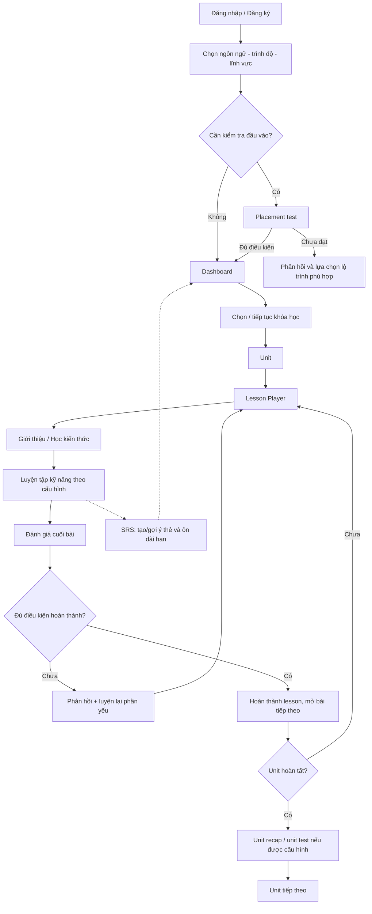
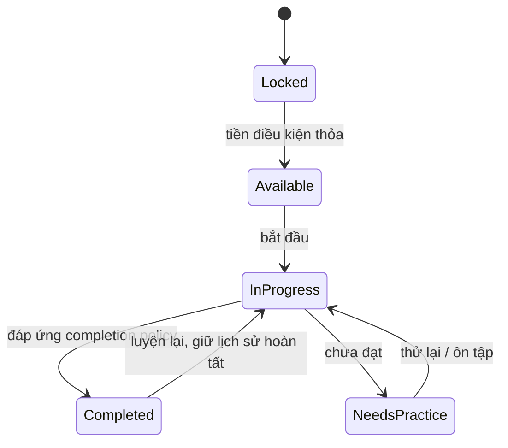
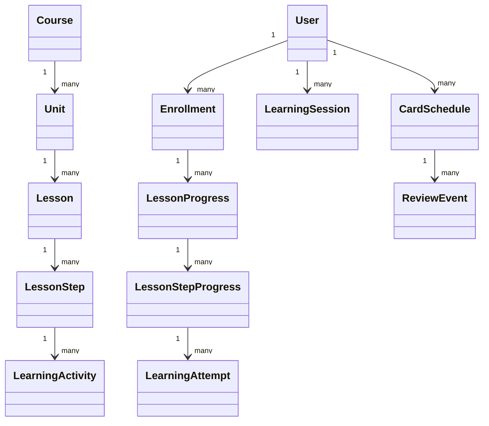

# LinguaFlow — Thiết kế lại hành trình học tập (Learning Journey Redesign)

> **Loại tài liệu:** Product Requirements Document (PRD) + UX Workflow + Technical Design + Implementation Plan  
> **Phiên bản:** 1.0 — 28/10/2026  
> **Trạng thái:** Đề xuất thiết kế, **chưa triển khai**  
> **Phạm vi:** Nền tảng học đa ngôn ngữ / đa trình độ / đa lĩnh vực; React + TypeScript, ASP.NET Core Web API, MySQL/EF Core.  
> **Căn cứ hiện trạng:** `current-learner-flow-audit.md` (kiểm kê mã nguồn 25/10/2026). Những phần không được kiểm kê xác minh được đánh dấu là **đề xuất**, không phải chức năng hiện hữu.

---

## 1. Tóm tắt quyết định

### 1.1. Vấn đề cần giải quyết

LinguaFlow hiện cung cấp khóa học, từ vựng, các tab kỹ năng, quiz và SRS, nhưng người học chưa có một hành trình thống nhất. Nút **“Bắt đầu học ngay”** trên khóa gợi ý mở kho từ vựng `/courses`, thay vì mở bài học. Nút tiếp tục dựa chủ yếu vào `LessonProgress`, không trở về chính xác bước đang học. Hoàn thành quiz có thể đánh dấu bài hoàn tất dù các hoạt động trong bài chưa thực hiện. Các kỹ năng và SRS có tiến độ độc lập, chưa tạo thành một trải nghiệm học liên tục.

### 1.2. Tầm nhìn sản phẩm

> **Một khóa học dẫn dắt người học đi qua từng bài học có mục tiêu, nội dung, hoạt động, phản hồi và đánh giá; SRS giúp ghi nhớ kiến thức lâu dài song song với hành trình đó.**

Không xây dựng một bộ tab luyện tập rời rạc; cũng không ép mọi người học vào cùng một khuôn 8 bước hoặc một trò chơi hóa giống Duolingo.

### 1.3. Các quyết định mặc định

1. **Course → Unit → Lesson → Lesson Step → Activity** là cấu trúc cốt lõi.
2. **Lesson** là đơn vị hoàn thành chính; **Unit** và **Course** tổng hợp từ các lesson bắt buộc.
3. **Lesson Player** là điểm vào mặc định khi bấm “Bắt đầu học ngay”, “Tiếp tục học”, hoặc chọn một bài trong lộ trình.
4. Nội dung lesson được khai báo bằng **danh sách bước có cấu hình**, không cứng hóa 8 bước cho mọi khóa.
5. Các tab nghe, nói, đọc, viết, ngữ pháp, từ vựng vẫn là **khu luyện tập tự do**, có thể sử dụng ngoài khóa; hoạt động có liên kết lesson sẽ cập nhật tiến độ tương ứng khi được thực hiện trong đúng ngữ cảnh.
6. **Chỉ backend quyết định Completed** bằng một bộ điều kiện hoàn thành thống nhất; client không tự gán trạng thái.
7. **SRS là hệ thống ôn tập độc lập**, không bắt người học đợi nhiều ngày để hoàn thành lesson. Kết quả luyện tập có thể gợi ý nội dung ôn, nhưng không tự động chuyển thành Again/Hard/Good/Easy khi không tương đương với bài kiểm tra ghi nhớ.
8. Dữ liệu cũ phải được giữ và chuyển đổi an toàn, không làm mất lịch sử học, quiz hay ôn thẻ.

### 1.4. Ngoài phạm vi giai đoạn đầu

- AI tự chấm chính xác phát âm như giám khảo, chấm luận văn tin cậy tuyệt đối.
- Tự động mở khóa toàn bộ A1 → C2 chỉ nhờ một bài quiz.
- Thay mới tất cả engine từ vựng, quiz, SRS; thiết kế ưu tiên tái sử dụng.
- Xây công cụ soạn giáo trình hoàn toàn mới nếu cấu trúc JSON import có thể mở rộng an toàn.

---

## 2. Hiện trạng xác minh và đích thay đổi

| Hạng mục | Hiện trạng theo kiểm kê | Thiết kế mục tiêu |
|---|---|---|
| `/home` khóa gợi ý | Nút khóa gợi ý mở `/courses` | Mở Lesson Player đúng lesson đầu tiên chưa hoàn thành |
| `/curriculum` | Danh mục + nội dung, link tới vocabulary và quiz | Trang danh mục + Lesson Player có stepper thống nhất |
| `/roadmap` | Cây khóa/unit/bài và 5 liên kết tĩnh; mở tự do | Lộ trình thể hiện điều kiện, bước hiện tại và nút Resume |
| `/courses` | Phiên từ vựng có `activeSessionId` và vị trí | Engine từ vựng tái sử dụng như một step của lesson; vẫn cho học tự do |
| Skill tabs | Mỗi kỹ năng có tiến độ riêng | Skill engine nhận `lessonStepId`, đồng bộ trạng thái được công nhận |
| Quiz | 70% là đạt; trả lời chưa nộp trong state frontend | Quiz nằm trong lesson; lưu draft, cho resume; đạt quiz chưa tự hoàn tất lesson |
| SRS | Thẻ đến hạn, đánh giá 4 mức, lịch hẹn hiện có | Dashboard trí nhớ, nhãn trạng thái, forecast, learning/relearning, gợi ý từ lỗi |
| Resume | Chọn lesson InProgress gần nhất, không nhớ nội bước | Resume chính xác course/unit/lesson/step/activity/session |
| Completed | Từ vựng hoặc quiz có thể tự đóng lesson ở các nhánh riêng | Completion Engine kiểm tra toàn bộ bước bắt buộc và rubric |

**Lưu ý:** Đây là phương án thay đổi dựa trên tài liệu kiểm kê mã nguồn, không khẳng định đã chạy end-to-end trên môi trường production.

---

## 3. Kiến trúc trải nghiệm học tập

### 3.1. Hành trình chính



### 3.2. Quy ước điều hướng

| Hành động | Đích |
|---|---|
| Trang chủ → “Bắt đầu học ngay” | `/learn/:courseId/:lessonId` với lesson phù hợp nhất |
| Trang chủ → “Tiếp tục học” | `/learn/:courseId/:lessonId?step=:stepId&activity=:activityId` |
| Lộ trình → lesson | Trang thông tin lesson hoặc Player theo quyền truy cập |
| Player → bài kế tiếp | Lesson kế tiếp trong unit; hết unit thì recap/unit assessment |
| Player → “Ôn từ đến hạn” | `/review` với context bài/khóa tùy chọn; trở về được |
| Sidebar → Từ vựng / Nghe / Nói / Đọc / Viết / Ngữ pháp | Practice Hub độc lập, không mất vị trí Player |
| Sidebar → Bộ thẻ | Quản lý deck/card, không nhầm với chương trình học |

**Không giữ hai ý nghĩa khác nhau cho cùng một nút “Tiếp tục học”.** Ngoài Player, nút riêng của từng khu vực có nhãn rõ: “Tiếp tục luyện từ”, “Tiếp tục ôn thẻ”, “Tiếp tục đề thi”.

### 3.3. Chính sách truy cập

- **Guided mode (mặc định):** bước bắt buộc cần hoàn thành theo thứ tự; nội dung trước đã xong có thể xem lại.
- **Explore mode (tùy chọn):** có thể xem trước lý thuyết và hoạt động, nhưng hệ thống hiển thị rõ hoạt động nào chưa đủ điều kiện tính tiến độ.
- **Practice Hub:** mở tự do. Không vô tình hoàn thành một lesson chỉ vì làm bài luyện tương tự không thuộc lesson.
- Khi đổi mục tiêu học, dữ liệu progress cũ giữ nguyên theo khóa/ngôn ngữ; chỉ thay context hiện tại.

---

## 4. Thiết kế lại Dashboard `/home`

### 4.1. Thứ tự nội dung

1. **Mục tiêu hiện tại**: ngôn ngữ, cấp độ, lĩnh vực, cho đổi có xác nhận.
2. **Khóa đang học**: tên khóa, % tiến độ thật, chương/bài hiện tại, nút nổi bật **“Tiếp tục bài X — Bước Y”**.
3. **Khóa gợi ý** (khi chưa ghi danh): nút **“Bắt đầu khóa học”**, trỏ đúng lesson đầu tiên, tuyệt đối không trỏ `/courses`.
4. **Hôm nay nên làm gì**: ưu tiên thẻ SRS đến hạn và 1 bài đang học; hiển thị thời lượng ước tính nếu dữ liệu có.
5. **Truy cập nhanh công cụ**: ôn SRS, luyện nghe/nói/đọc/viết, deck, quiz tự do.
6. **Thống kê nhỏ**: streak, số phút học (nếu đo đáng tin), số lesson hoàn tất, thẻ đến hạn.

### 4.2. Các trạng thái

- **Chưa có mục tiêu**: hiển thị hành động chọn mục tiêu.
- **Có mục tiêu nhưng chưa có khóa**: đề xuất khóa và giải thích cấp độ/lĩnh vực.
- **Mới bắt đầu**: “Bắt đầu chương 1 — bài 1”.
- **Đang học dở**: “Tiếp tục từ bước 4/7: Listening”.
- **Đã hoàn thành khóa**: “Xem tổng kết / chọn mục tiêu tiếp theo”; không tự chuyển cấp độ.
- **API lỗi hoặc khóa không có bài**: lỗi rõ ràng + thử lại; không chuyển hướng sang từ vựng như fallback âm thầm.

### 4.3. Quy tắc resume trang chủ

Ưu tiên (1) phiên học chính active đã ghi nhận, (2) lesson InProgress có step chưa hoàn tất, (3) lesson kế tiếp đã mở khóa, (4) lesson đầu tiên của khóa. SRS đến hạn xuất hiện ở ô riêng, **không chiếm hoặc ghi đè Resume của course**.

---

## 5. Thiết kế Lesson Player — thành phần trọng tâm

### 5.1. Bố cục desktop / mobile

- **Header:** breadcrumb khóa/chương/bài, tên lesson, tiến độ, nút quay lại lộ trình.
- **Stepper/Outline:** các bước bài học, trạng thái Locked/Available/InProgress/Completed/NeedsPractice; desktop sidebar trong Player, mobile dạng danh sách thu gọn.
- **Content:** khung nội dung bước hiện tại, hỗ trợ đoạn văn, media, minh họa, hội thoại, câu hỏi tương tác.
- **Footer:** “Trước”, “Lưu và thoát”, “Kiểm tra đáp án”, “Tiếp tục”. Điều kiện nút phản ánh quy tắc bước.
- **Feedback:** đúng/sai kèm giải thích, lỗi thường gặp, lựa chọn học lại; không chỉ âm báo.
- **Accessibility:** bàn phím, transcript/caption, nhãn nút, không dựa vào màu làm tín hiệu duy nhất.

### 5.2. Các loại bước được hỗ trợ

| Step type | Vai trò | Cách xác nhận hoàn thành |
|---|---|---|
| `introduction` | Mục tiêu, bối cảnh, kiến thức nền | Xem/xác nhận đã đọc; không coi đây là đạt năng lực |
| `vocabulary` | Giới thiệu từ + thực hành có feedback | Hoàn tất session từ vựng theo rule |
| `grammar` | Giải thích cấu trúc + bài áp dụng | Đúng tối thiểu theo tiêu chí định nghĩa |
| `listening` | Nghe hội thoại / câu hỏi theo bối cảnh | Đạt số câu hoặc hoàn thành mức practice được định nghĩa |
| `speaking` | Nghe mẫu, thu âm, hội thoại | `Practiced` hoặc `Passed` theo policy, **không mặc định là phát âm chuẩn** |
| `reading` | Đọc và trả lời câu hỏi | Đạt threshold hoặc hoàn tất hoạt động |
| `writing` | Viết theo đề, lưu bản nháp | Submitted/Practiced; chỉ `Passed` khi có chấm theo rubric |
| `quiz` | Đánh giá cuối lesson | Đạt ngưỡng mặc định 70%, có thể cấu hình |
| `recap` | Tổng kết kiến thức | Xem và hoàn thành theo điều kiện cấu hình |
| `custom` | Bước tùy ngôn ngữ (nét chữ, IPA, v.v.) | Theo implementation của plugin step |

**Ví dụ A1 IT:** Introduction → Vocabulary → Grammar → Listening → Speaking → Reading → Writing → Quiz. Đây là **một template**, không phải thứ tự bắt buộc cho toàn bộ C1/C2, tiếng Nhật, tiếng Hàn hoặc tiếng Trung.

### 5.3. State machine cho từng bước



- “Đã thực hành” (`Practiced`) là **kết quả activity**, không mặc nhiên đồng nghĩa `Passed`.
- Một bài có writing không thể tự chấm có thể định nghĩa `submission_required` để hoàn tất bước ở chế độ cơ bản; UI hiển thị rõ “Đã nộp — chưa đánh giá chất lượng”.
- Khi bước đã completed và làm lại, không xóa completed trước đó; giữ lịch sử attempt và phiên mới.

### 5.4. Điều kiện hoàn thành lesson

**Backend hoàn thành lesson khi và chỉ khi:**

1. Tất cả **required steps** đáp ứng completion policy đã khai báo.
2. Có quiz bắt buộc thì phải đạt ngưỡng (mặc định 70%).
3. Không có bước còn chờ chấm mà policy yêu cầu `Passed`.
4. Course/lesson hợp lệ, trạng thái không bị đóng hoặc thu hồi.

Các bước `optional` không chặn hoàn thành. Không dùng số lượng từ đã xem hay lượt nghe làm bằng chứng đạt ngữ pháp/nói/viết. **Đạt quiz một mình không đủ để auto-complete lesson.** Các bước không có dữ liệu phải được báo lỗi cấu hình/được quản trị xử lý; không silently auto-complete.

### 5.5. Một bài cụ thể (Acceptance Journey)

**Course:** English A1 — IT  
**Unit 1:** Getting Started with IT  
**Lesson 1:** Computer Basics

1. Người dùng bấm **“Bắt đầu học ngay”** tại Home.
2. Player mở Introduction, có mục tiêu “nêu tên thiết bị máy tính và mô tả chức năng cơ bản”.
3. Vocabulary: `keyboard`, `monitor`, `mouse`, ...; engine cũ giới thiệu, hỏi và luyện lại lỗi; thẻ được tạo hoặc liên kết lịch SRS sau phiên.
4. Grammar: `This is a ...` / `These are ...`, có giải thích và kiểm tra áp dụng.
5. Listening: nghe hội thoại về thiết bị rồi trả lời.
6. Speaking: nói 2–3 câu mô tả; nếu hệ thống chưa có scoring đáng tin, hiển thị “Đã luyện nói”, không hiển thị “Phát âm chính xác 95%”.
7. Reading/Writing theo dữ liệu bài.
8. Quiz: đạt 70% nhưng nếu còn một bước bắt buộc chưa đủ điều kiện, Player báo còn bước nào.
9. Sau hoàn tất: màn tổng kết, mở Lesson 2 và hiện thẻ đến hạn khi có.
10. Rời ở bước Listening/câu 2 rồi đăng nhập lại: trở về đúng bước và phiên/câu có dữ liệu đã lưu.

---

## 6. Roadmap / Learning Path

### 6.1. Cấu trúc màn hình

- Cấp khóa: mục tiêu, tiến độ tổng, unit hiện tại.
- Cấp unit: số lesson hoàn thành/tổng lesson bắt buộc, trạng thái, recap/test nếu có.
- Cấp lesson: tên, độ khó, thời lượng dự kiến (nếu có), trạng thái, bước đang làm, hành động.
- Cho phép xem đề cương ngay cả khi lesson chưa mở; không dùng khóa UI để che toàn bộ nội dung mô tả.

### 6.2. Quy tắc mở khóa

- Mặc định lesson tiếp theo mở khi lesson trước được Completed.
- Cho phép course cấu hình `sequential` hoặc `open_navigation`; chuyển hướng có thông báo minh bạch.
- Unit test nếu bắt buộc thì phải đạt trước khi chuyển sang unit mới; nếu không có thì tổng hợp từ lesson.
- Admin được phép chỉnh policy cho khóa **mới**; nếu thay đổi policy khóa đang học cần versioning tránh phá progress.

### 6.3. Tiến độ

Không tính tiến độ bằng số lần vào trang. Gợi ý:

- `lessonCompletion`: Completed = 100%; đang học = tổng trọng số required step hoàn thành / tổng trọng số required step; một số hoạt động có partial progress riêng.
- `unitCompletion`: tỉ lệ lesson bắt buộc đã completed; có thể hiển thị thêm “đang học” riêng.
- `courseCompletion`: tỉ lệ lesson bắt buộc đã completed; chỉ 100% khi toàn bộ điều kiện khóa đạt (gồm unit assessment bắt buộc nếu có).
- Trạng thái `Completed` tách khỏi `%` hiển thị, tránh 100% khi quiz đang chờ chấm.

---

## 7. Thiết kế lại SRS — Memory Center

### 7.1. Vai trò, không nhầm với luyện tại bài

- **Immediate practice:** lặp lỗi ngắn hạn bên trong activity để hình thành kiến thức.
- **SRS:** thử nhớ lại sau khoảng cách thời gian, xếp lịch tái ôn, củng cố trí nhớ dài hạn.
- Một từ sai trong Listening có thể được **đề xuất ôn/luyện thêm**; không tự suy ra rating SRS nếu câu chỉ là nhận diện đáp án.

### 7.2. Trang `/review`

Hiển thị 4 nhóm rõ nghĩa: **New** (chưa giới thiệu/ôn), **Learning**, **Review**, **Relearning**; kèm **Due today** (số thẻ đến hạn) như chỉ số riêng. Hiển thị tổng số thẻ trong từng nhóm, dự báo số thẻ đến hạn 7 ngày, bộ lọc theo ngôn ngữ/khóa/lesson/deck, lịch sử ôn và thời gian ôn gần nhất. Không hiển thị “Mastered vĩnh viễn”: nhãn “ghi nhớ ổn định” chỉ thể hiện trạng thái ước lượng có thể thay đổi.

**Chú ý:** Việc áp dụng các trạng thái New/Learning/Review/Relearning là **đề xuất model mới**; dữ liệu nguồn hiện tại mới được kiểm kê là due/future/new và lịch hẹn.

### 7.3. Luồng ôn một thẻ

1. Hiện mặt trước (từ/câu/audio), người học thử tự nhớ.
2. Yêu cầu lật mới hiện đáp án, phiên âm, ví dụ và giải thích.
3. Chấm: **Again** (không nhớ), **Hard** (nhớ khó), **Good** (nhớ được), **Easy** (nhớ rất dễ).
4. Server lưu `ReviewEvent`, tính `nextDueAt` và nhãn trạng thái; frontend hiển thị ngày/giờ dự kiến nếu scheduler hỗ trợ.
5. Khi Again: đưa vào relearning và cho gặp lại trong một phiên phù hợp, không lập tức xóa tiến độ học.
6. Hết lô: báo số thẻ đã ôn **trong lô**, số còn đến hạn nếu có, nút tải lô mới; không nói “đã ôn xong tất cả” khi chưa xác nhận.

### 7.4. Quy tắc tạo thẻ và chống trùng

- Dùng khóa định danh logic `(userId, language, normalizedLexeme, senseId, cardDirection, sourceScope)` tùy thiết kế; tránh tạo bản sao chỉ do từ xuất hiện ở nhiều lesson.
- Một từ có nhiều nghĩa/ngữ cảnh có thể tạo **nhiều sense cards** nếu thật sự khác nhau.
- Thẻ của giáo trình và thẻ cá nhân có nguồn gốc rõ (`course`, `manual`, `import`, `shared`).
- Chỉ tạo lịch ôn ở lần giới thiệu hợp lệ hoặc khi người học chủ động thêm; không tự tạo khi chỉ mở bài đọc.
- Hỗ trợ audio, examples, IPA, câu điền ngữ cảnh nếu dữ liệu hiện hữu; không phát âm bằng audio không xác minh.

### 7.5. Thuật toán scheduling

**Giai đoạn 1:** giữ thuật toán hiện có (Again ~10 phút, Good thường 1 ngày → 6 ngày, các mức Hard/Easy như kiểm kê), bổ sung trạng thái, telemetry, quality controls và UI. **Giai đoạn 2:** đánh giá FSRS có dữ liệu lịch sử đủ tốt, kiểm thử backtest/retention trước khi chuyển; không hứa FSRS luôn tốt hơn nếu thiếu lịch sử chất lượng. Version hóa scheduler (`algorithmVersion`), tránh tính lại toàn bộ lịch cũ trong một lần deploy không kiểm soát.

### 7.6. Liên kết SRS với Lesson Player

| Sự kiện học | Phản ứng |
|---|---|
| Hoàn tất session từ mới | Gắn thẻ nguồn lesson, lên lịch theo quy tắc |
| Trả lời sai hoạt động liên quan từ | Ghi `LearningEvidence` và đề xuất luyện tập; không ép rating |
| Ôn flashcard Again | Điều chỉnh lịch, có thể gợi ý bài học chứa từ |
| Ôn flashcard Good/Easy | Điều chỉnh lịch; không auto-complete lesson chưa học |
| Lesson Completed | Hiển thị số thẻ đã tạo và thời điểm ôn kế tiếp nếu có |
| Đổi khóa/ngôn ngữ | Không xóa lịch ôn cũ; lọc theo scope người dùng chọn |

---

## 8. Learning Progress Engine (backend là nguồn chân lý)

### 8.1. Mô hình thực thể đích



### 8.2. Bảng/trường tối thiểu (đề xuất)

| Entity | Trường trọng tâm | Ý nghĩa |
|---|---|---|
| `Course`/`Unit`/`Lesson` | IDs, order, status, `contentVersion` | Định danh cấu trúc giáo trình hiện hữu/mở rộng |
| `LessonStep` hoặc step JSON | `id`, `type`, `order`, `required`, `completionPolicy`, `activityRefs` | Định nghĩa trình tự và điều kiện |
| `Enrollment` | `userId`, `courseId`, `status`, `startedAt` | Tách đăng ký khóa khỏi mục tiêu học |
| `LessonProgress` (hiện có) | user/course/lesson, status, completedAt, version | Trạng thái tổng hợp, chỉ Engine ghi Completed |
| `LessonStepProgress` (mới) | user/lesson/step, status, score, attempts, timestamps | Theo dõi đến từng bước |
| `LearningSession` (mới/mở rộng) | `userId`, `courseId`, `lessonId`, `stepId`, `activityId`, `attemptId`, `cursor`, `updatedAt` | Resume chính xác, tránh lệ thuộc frontend state |
| `LearningAttempt` (mới/adapter) | activity, answer, correctness, score, evaluator, timestamps | Lịch sử hoạt động; tái sử dụng dữ liệu quiz/skill hiện có |
| `CardSchedule`/`ReviewEvent` (hiện có) | due, rating, event log, version | SRS riêng, không gắn thẳng với Lesson Completed |
| `LearningEvidence` (tùy chọn) | activity/lexeme/outcome/context | Dữ liệu gợi ý luyện, không phải lịch SRS |

**Thực thi:** không cần nhân đôi `QuizAttempt`, `VocabularySession`, `SkillPracticeProgress` và `WritingSubmission` đang tồn tại. Có thể tạo **adapter/reference IDs** thay vì chuyển toàn bộ dữ liệu ngay sang `LearningAttempt`.

### 8.3. Quy tắc ghi dữ liệu nguyên tử

- Submit activity: validate → ghi attempt/source session → tính trạng thái step → tính trạng thái lesson → cập nhật resume cursor → commit một transaction khi có thể.
- SRS scheduling xảy ra khi event hợp lệ và **idempotent**; retry không tạo trùng card hoặc cộng đôi tiến độ.
- `idempotencyKey` cho submit/complete; tránh bấm hai lần làm ghi hai lượt.
- Backend tính điều kiện, frontend chỉ hiển thị; không tin điểm số từ client.
- Cho phép phiên đang dở trên nhiều thiết bị: áp dụng optimistic concurrency/version hoặc hiển thị xung đột cập nhật.
- Lưu `contentVersion` trong attempt để không chấm bài cũ bằng đáp án phiên bản mới.

### 8.4. Pseudocode hoàn thành bài

```text
EvaluateLessonCompletion(userId, lessonId):
    lesson = loadPublishedLessonWithVersion(lessonId)
    required = lesson.steps.filter(step => step.required)
    for step in required:
        progress = loadStepProgress(userId, step.id)
        if !satisfies(step.completionPolicy, progress):
            return InProgress(missingStepIds)
    if lesson.requiredFinalQuiz and !hasPassedQuiz(userId, lessonId, lesson.quizPolicy):
        return InProgress([finalQuizStepId])
    markLessonCompletedIdempotently(userId, lessonId)
    unlockNextLessonIfEligible(userId, lessonId)
    return Completed
```

### 8.5. Resume Engine

API chọn **một** con trỏ chính cho luồng khóa học: lesson đang active gần nhất + step đầu tiên chưa đạt (hoặc activity đang làm dở với state phục hồi hợp lệ). Quiz câu trả lời nháp cần lưu server theo session, không chỉ component state. Resume không lôi người học sang `/review` khi đang học lesson; SRS là CTA ưu tiên phụ.

---

## 9. API contract mục tiêu (gợi ý, chưa tồn tại)

| Method | Endpoint đề xuất | Chức năng |
|---|---|---|
| GET | `/api/learning/home` | Mục tiêu, active course, resume, due summary |
| GET | `/api/learning/courses/{courseId}/roadmap` | Cây unit/lesson/step và lock state |
| POST | `/api/learning/courses/{courseId}/enroll` | Ghi danh idempotent |
| GET | `/api/learning/lessons/{lessonId}` | Definition lesson và policy (lọc dữ liệu an toàn) |
| POST | `/api/learning/lessons/{lessonId}/start` | Tạo/phục hồi session |
| GET | `/api/learning/resume` | Con trỏ chính: course/lesson/step/activity/cursor |
| POST | `/api/learning/sessions/{sessionId}/checkpoint` | Lưu nháp/vị trí trong phiên |
| POST | `/api/learning/steps/{stepId}/submit` | Submit activity → cập nhật progress |
| GET | `/api/learning/lessons/{lessonId}/progress` | Step states + missing requirements |
| POST | `/api/learning/lessons/{lessonId}/evaluate` | Server tái tính hoàn thành, không override |
| GET | `/api/srs/dashboard` | New, Learning, Review, Relearning, due, forecast |
| POST | `/api/srs/reviews` | Rating event, due tiếp theo (tái sử dụng endpoint hiện hữu nếu được) |

**Không bắt buộc tạo toàn bộ endpoint mới:** thích ứng API hiện tại trong Application Service/Facade; hạn chế break API frontend cũ. Cần đặt URL chính thức theo convention của repo khi triển khai.

### 9.1. Ví dụ trả về Resume

```json
{
  "courseId": "course-guid",
  "unitId": "unit-guid",
  "lessonId": "lesson-guid",
  "stepId": "step-listening-guid",
  "activityId": "listening-activity-guid",
  "sessionId": "session-guid",
  "cursor": { "questionIndex": 1 },
  "lessonStatus": "InProgress",
  "resumeLabel": "Tiếp tục Bài 1 — Nghe (câu 2/5)",
  "contentVersion": 3
}
```

### 9.2. Ví dụ step definition

```json
{
  "id": "step-vocabulary-01",
  "type": "vocabulary",
  "title": "Từ vựng: Thiết bị máy tính",
  "order": 2,
  "required": true,
  "completionPolicy": {
    "kind": "session_completed",
    "minimumScore": null
  },
  "activityRefs": ["vocabulary-lesson-01"]
}
```

---

## 10. Chiến lược giáo trình và JSON import

**Không được thay đổi tùy tiện schema JSON hiện hành** khi chưa đối chiếu validator và các khóa đã import. Thiết kế bước mới nên đi theo một trong hai phương án:

- **A — Sidecar definition (ưu tiên để migrate an toàn):** lưu `LessonFlowDefinition` gắn lesson hiện có, tham chiếu nội dung từ `Course.MaterialJson` qua ID ổn định; giữ nguyên payload import v1.
- **B — Versioned JSON v2:** bổ sung `lessonSteps`, `completionPolicy`, `activityRefs` và nâng version importer/validator; giữ đường xử lý v1.

### Nguyên tắc

1. Không tự dựng nội dung giả cho trường thiếu; báo cho quản trị “Thiếu listening activity” hay “Quiz chưa có câu hỏi”.
2. Validate trước khi publish: thứ tự, ID duy nhất, activityRef tồn tại, dữ liệu bắt buộc, policy có thể được chấm.
3. Khi JSON cũ thiếu step definition, có thể **tạo bản nháp mapping** từ trường hiện có để admin duyệt; không tự coi là đầy đủ.
4. Cố định version nội dung đối với attempt đang dở; có chiến lược cho bài bị thay đổi/xóa.
5. Hỗ trợ đặc thù ngôn ngữ: `custom` step cho luyện nét Hán/Nhật/Hàn, IPA, phân biệt âm, v.v.
6. A1/A2/B1/B2/C1/C2 có template khác nhau, không suy ra mọi lesson đều có đủ bốn kỹ năng.

---

## 11. UX chi tiết và microcopy

### 11.1. Đổi nhãn

| Hiện tại/không rõ | Đề xuất |
|---|---|
| “Bắt đầu học ngay” (đi sang từ vựng) | “Bắt đầu Bài 1” hoặc “Tiếp tục Bài 3 — Nghe” |
| “Khóa học & Bài học” (quick link chung chung) | “Hành trình học” |
| “Ôn tập SRS” | “Ôn tập ghi nhớ” (giữ SRS trong giải thích) |
| “Đã học” khi chỉ xem nội dung | “Đã xem” hoặc “Đã thực hành” |
| “Hoàn thành bài” khi chỉ đạt quiz | “Đã đạt quiz — còn 2 bước bắt buộc” |
| “Hoàn tất phiên” khi hết 30 thẻ | “Đã ôn 30 thẻ trong lượt này” |

### 11.2. Các trạng thái giao diện thiết yếu

Loading skeleton; empty data; offline; API retry; lesson bị cập nhật; hoạt động thiếu audio/media; submit lỗi nhưng dữ liệu nháp còn; quiz quá hạn; thiếu quyền; course đã hoàn tất; khi back giữa bài phải lưu checkpoint và giải thích nếu chưa được lưu. Không hiển thị thành công khi backend chưa xác nhận.

### 11.3. Mobile

Stepper thu gọn thành “Bước 3/8”; nội dung 1 cột; nút Tiếp tục bám cuối màn nhưng không che input; audio có play/pause/repeat; các bài matching/drag có lựa chọn thao tác bằng chạm hoặc bàn phím.

---

## 12. Kế hoạch triển khai theo pha, không phá chức năng cũ

### P0 — Hành trình học hoạt động end-to-end

- [ ] Chốt model `LessonStep`, `completionPolicy` và mapping nội dung hiện hữu.
- [ ] Tạo `LessonStepProgress` và session/cursor dùng chung; migration EF Core an toàn.
- [ ] Viết Completion Engine ở backend; chặn các nhánh quiz/vocab trực tiếp tự set lesson Completed khi chưa đủ điều kiện.
- [ ] Viết Resume Engine có step/activity/cursor; hoạt động tương thích với phiên vocabulary hiện hữu.
- [ ] Tạo Lesson Player với stepper, navigation, checkpoint, feedback và recap.
- [ ] Sửa Home, Roadmap, CTA khóa học để mở Lesson Player.
- [ ] Tích hợp vocabulary + quiz vào Player, bao gồm lưu quiz draft.
- [ ] E2E: user mới → enroll → lesson → quiz → completion → lesson kế.

**Definition of Done P0:** người dùng bấm “Bắt đầu học ngay” không vào `/courses`; rời/reload trở về đúng bước; Completed không bị ghi nhầm khi chỉ đạt quiz; dữ liệu học hiện có không mất.

### P1 — Học tập có chiều sâu

- [ ] Tích hợp grammar, listening, speaking, reading, writing theo `activityRefs`.
- [ ] Chính sách `Practiced` vs `Passed` cho nói/viết, có thông điệp trạng thái minh bạch.
- [ ] Roadmap unit/course completion và điều kiện mở khóa.
- [ ] Home gợi ý buổi học hôm nay; progress và ngày học.
- [ ] SRS Memory Center: trạng thái, forecast, filter, nhãn hạn ôn.
- [ ] Liên kết lesson/card qua source references, dedup card.
- [ ] Bộ validation/bản đồ giáo trình cho admin.

**Definition of Done P1:** mỗi lesson có thể chạy các step được cấu hình; kỹ năng ghi tiến độ đúng; SRS được hiểu là ôn dài hạn, không lẫn completed lesson.

### P2 — Cá nhân hóa nâng cao

- [ ] LearningEvidence và gợi ý luyện lỗi thường gặp.
- [ ] Báo cáo theo kỹ năng/knowledge point, không chỉ số lượt click.
- [ ] Đánh giá FSRS với lịch sử SRS và A/B test nếu đủ quy mô.
- [ ] Template chuyên biệt theo ngôn ngữ (IPA, luyện nét, hội thoại, ngữ pháp nâng cao).
- [ ] Versioning nội dung/policy, dashboard chất lượng bài và cảnh báo thiếu dữ liệu.

**Definition of Done P2:** người học thấy đề xuất có lý do, lịch ôn được theo dõi và điều chỉnh có kiểm chứng; khóa v1 không bị lỗi khi v2 được import.

---

## 13. Test cases và tiêu chí chấp nhận

| ID | Tình huống | Kết quả bắt buộc |
|---|---|---|
| T01 | User chưa học bấm “Bắt đầu học ngay” | Mở Lesson 1/step 1, không mở `/courses` |
| T02 | User đang học dở Listening câu 2 rồi refresh | Khôi phục đúng lesson/step/câu đã lưu |
| T03 | Vocabulary hoàn thành nhưng grammar chưa | Vocabulary step Completed; lesson vẫn InProgress |
| T04 | Quiz đạt 80%, writing bắt buộc chưa nộp | Quiz step Completed; lesson chưa Completed |
| T05 | Đủ toàn bộ required steps + quiz đạt | Lesson Completed đúng 1 lần; lesson sau mở khóa |
| T06 | Bước optional chưa hoàn thành | Không chặn lesson Completed |
| T07 | Nói chỉ nhận dạng được transcript | Ghi Practiced, không tuyên bố điểm phát âm |
| T08 | Viết đã submit, policy đòi review | PendingReview, chưa Passed |
| T09 | Submit một đáp án hai lần do retry | Không tạo duplicate attempt/progress/thẻ |
| T10 | Học từ xuất hiện trong 2 lesson | Không có thẻ trùng theo chính sách dedup |
| T11 | SRS Due = 0 nhưng còn New | UI phân biệt đúng, vẫn cho bắt đầu New khi hợp lệ |
| T12 | Ôn hết batch 30 thẻ nhưng còn thẻ due | Không nói đã ôn hết ngày |
| T13 | Đổi ngôn ngữ/mục tiêu | Không xóa progress và SRS của mục tiêu cũ |
| T14 | Admin sửa lesson giữa phiên | Resume theo contentVersion/luồng migrate rõ ràng |
| T15 | Step bắt buộc không có dữ liệu | Báo cấu hình lỗi, không tự coi Completed |
| T16 | User mở quiz trực tiếp từ sidebar | Chế độ luyện tự do không bypass completion policy |
| T17 | Hai thiết bị cùng cập nhật một session | Không mất câu trả lời âm thầm hoặc nhân đôi progress |
| T18 | Học ngoại tuyến rồi đồng bộ | Có xử lý trùng event và xung đột minh bạch |

### Chỉ số đánh giá sau phát hành (không đặt số liệu tùy tiện)

- Tỉ lệ bấm CTA và đến được bước 1 thành công.
- Tỉ lệ quay lại đúng vị trí sau refresh/thoát.
- Tỉ lệ hoàn tất lesson/unit; số bước bị bỏ giữa chừng.
- Tỉ lệ quiz đạt, retry, missing required step.
- SRS: số thẻ đến hạn, retention quan sát được, tỷ lệ ôn quá hạn, gánh nặng thẻ mới/ngày.
- Sự cố tiến độ: số Completed sai, mismatch status hoặc thẻ trùng.

---

## 14. Migration checklist cho codebase đang có

**Frontend (theo vị trí đã được kiểm kê):**

- `frontend/src/App.tsx`: thêm route Player, giữ tương thích `/curriculum`, `/courses`, `/quiz`, các tab kỹ năng.
- `frontend/src/features/home/HomeView.tsx`: đổi CTA khóa học và Resume.
- `frontend/src/features/roadmap/LearningRoadmapView.tsx`: step progress và lock state.
- `frontend/src/features/courses/CourseCatalogView.tsx`: phân biệt catalog giáo trình và vocabulary hub.
- `frontend/src/features/reviews/VocabularyLearningView.tsx` và `frontend/src/features/vocabulary/VocabularyHubView.tsx`: cho phép embedded workflow, đồng thời giữ luồng độc lập.
- `frontend/src/features/quiz/QuizHubView.tsx`, `QuizPlayerView.tsx`: activity adapter, checkpoint câu hỏi, context lesson.
- `frontend/src/features/practice/...`: đồng bộ `LessonStepProgress`, không dùng `Practiced` làm `Passed` ngầm.
- `frontend/src/features/reviews/SrsReviewView.tsx`: Memory Center, giữ event rating backend.

**Backend (theo vị trí đã được kiểm kê):**

- `ProgressService.cs`: hợp nhất resume/lesson completion từ nhiều nguồn.
- `VocabularySessionService.cs`: không trực tiếp hoàn thành cả lesson chỉ vì xong từ vựng; phát domain event.
- `QuizService.cs`: quiz đạt là dữ liệu đầu vào cho Completion Engine, không phải điều kiện duy nhất.
- `SkillPracticeService.cs`: mapping activity → step, ghi progress an toàn.
- `WritingSubmissionService.cs`: giữ `Submitted`/`Practiced`/`Reviewed` phân biệt.
- `SrsService.cs`, `SrsScheduler.cs`: bổ sung trạng thái/forecast/versioning trong các pha phù hợp.
- `StudyTargetService.cs`, `PlacementService.cs`: giữ onboarding và proof hiện có; không gây mất tiến độ.

**Migrations:** thêm bảng/cột theo hướng additive → backfill/adapter → bật feature flag cho Player → đo lỗi → thay CTA mặc định → deprecate nhánh ghi Completed cũ sau khi kiểm chứng. Không drop dữ liệu lịch sử trong cùng release.

---

## 15. Phân công công việc mẫu theo dependency

| Epic | Nội dung | Phụ thuộc | Mức ưu tiên |
|---|---|---|---|
| LF-01 | Step schema, mapping/import validation | Không | P0 |
| LF-02 | StepProgress + Session + migration | LF-01 | P0 |
| LF-03 | Completion/Resume Engine | LF-01, LF-02 | P0 |
| LF-04 | Lesson Player shell/stepper | LF-01 | P0 |
| LF-05 | Vocabulary & Quiz adapters | LF-03, LF-04 | P0 |
| LF-06 | Home/Roadmap/route + E2E | LF-03–05 | P0 |
| LF-07 | Skill adapters + speaking/writing policy | LF-03, LF-04 | P1 |
| LF-08 | SRS Memory Center & card attribution | LF-02, LF-05 | P1 |
| LF-09 | Content QA + admin validation | LF-01, LF-07 | P1 |
| LF-10 | LearningEvidence + analytics | LF-07–09 | P2 |
| LF-11 | Scheduler experiments/FSRS evaluation | LF-08 | P2 |

---

## 16. Điều kiện không được vi phạm khi code

1. **Không** để “Bắt đầu khóa” đi vào tab từ vựng.
2. **Không** gán `LessonProgress.Completed` chỉ vì xem trang, luyện xong vocabulary, hoặc đạt quiz trong khi còn required step.
3. **Không** gọi `Practiced` là `Passed` khi không có bằng chứng chấm phù hợp.
4. **Không** tạo thẻ SRS trùng từ retry hoặc xuất hiện cùng từ ở nhiều bài.
5. **Không** dùng thẻ SRS đến hạn làm điều kiện chặn mở lesson tiếp theo.
6. **Không** bỏ mất session/draft của người dùng khi refresh, back hoặc đổi thiết bị mà không thông báo.
7. **Không** phá schema JSON import hiện hữu mà thiếu versioning/migration.
8. **Không** tự chế nội dung còn thiếu hoặc tự hoàn thành các step bị lỗi cấu hình.
9. **Không** đưa một template cứng nhắc lên mọi trình độ và ngôn ngữ.
10. **Không** thay thế toàn bộ hệ thống đã có khi adapter đủ giải quyết vấn đề.

---

## 17. Kết luận và mốc bàn giao

**Ưu tiên sản phẩm duy nhất:** xây **Lesson Player + Learning Progress Engine** trước. Đây là trục xương sống khiến khóa học, từ vựng, kỹ năng, quiz và SRS trở thành một hệ thống học thực sự.

**Bản giao P0 nên demo được:**

> Home → Bắt đầu English A1 IT → Unit 1 / Lesson 1 → Introduction → Vocabulary → Grammar → Listening → ... → Quiz → Tổng kết → Lesson 2. Người học có thể rời giữa chừng và tiếp tục đúng chỗ; thẻ được ôn theo lịch dài hạn ở Memory Center độc lập.

**Tài liệu này là đặc tả mong muốn**, không phải tuyên bố đã chỉnh sửa code hay database. Khi triển khai cần khảo sát schema thực tế/validator và tạo migration + automated tests trước khi thay đổi hành vi production.

---

## 18. Trạng thái triển khai trong repository (28/10/2026)

Phần đã triển khai theo đặc tả: CTA khóa học ở Home mở Lesson Player; lộ trình hiển thị cây khóa/chương/bài; Player đọc `lessonSteps` hoặc suy ra từ nội dung cũ, mở tuần tự các bước, lưu bước và vị trí hoạt động trên server. Quiz lưu nháp sau mỗi câu đã chuyển, từ vựng và kỹ năng tiếp tục dùng API hiện có. Backend đánh giá các bước bắt buộc trước khi ghi `LessonProgress.Completed`; hoàn tất riêng từ vựng hoặc quiz không còn tự hoàn thành cả bài. Resume lưu bước đầu tiên chưa đạt. Memory Center hiển thị New/Learning/Review/Relearning, thẻ đến hạn và dự báo bảy ngày. JSON mẫu, kiểm tra import phía client/server và hướng dẫn soạn `lessonSteps` đã cập nhật ở `docs/templates/README.md`. Migration EF và đường nâng cấp schema cho database cũ đều có trong mã.

**Tiếp tục ngày 28/10:** Lần đầu mở Lesson Player nay tạo `InProgress` và ghi danh khóa học bằng API idempotent hiện có. Resume trả thêm `activityId` và `cursor`; test tích hợp kiểm tra dữ liệu này cùng bản nháp bước được đọc lại sau checkpoint. Bài viết trong Player tự lưu nháp lên server sau khi người học dừng gõ, đồng thời chờ lưu trước khi chuyển bước hoặc bấm “Lưu và thoát”. Bước nói có nhận dạng giọng nói của trình duyệt để hiện bản chép lời tham khảo; người học vẫn xác nhận đã luyện, không có điểm phát âm. Bộ test: 52 unit và 61 integration đạt; frontend production build đạt.

Checkpoint của bước từ vựng/quiz chấp nhận `activityId` thuộc nội dung bài khi `activityRefs` trong JSON được để trống (nghĩa là lấy toàn bộ mục của phần đó). Quiz Player lưu ID nội dung từ JSON giáo trình cho câu kế tiếp, vì ID câu hỏi trong bảng quiz được tạo riêng khi import. Điều này giúp Resume trả về nguồn hoạt động đúng mà không nhầm hai loại ID.

Giới hạn hiện tại cần tiếp tục phát triển: hệ thống đã dùng `CourseEnrollment` hiện hữu nhưng đã bổ sung `LearningSession` và `LearningEvidence` theo bước; đã xử lý xung đột checkpoint từng bước, nhưng chưa có idempotency key thống nhất cho mọi activity. Bản nháp writing lưu theo nhịp dừng gõ và nút thoát của Player; đóng tab ngay trước lượt lưu cuối vẫn có rủi ro mất vài ký tự. Speaking trong Player chỉ ghi đã luyện sau khi người học xác nhận, chưa chấm phát âm. Trạng thái SRS hiện suy ra từ `Repetitions/Lapses` của scheduler cũ, chưa là state machine chuyên biệt; dự báo theo ngày UTC. Đã có bộ lọc SRS theo lesson và tỷ lệ nhớ quan sát trên lượt ôn đến hạn từ dữ liệu mới; chưa có đánh giá FSRS. Nội dung lesson cũ thiếu `lessonSteps` dùng thứ tự suy ra; admin cần bổ sung mục tiêu/ngữ cảnh và chính sách riêng khi biên soạn mới. Cần kiểm tra trực tiếp trên database MySQL và trình duyệt đang chạy sau khi khởi động lại API; test tự động dùng SQLite in-memory.

**Checkpoint đa thiết bị (28/10):** Mỗi bước học có revision tăng dần. Player gửi revision đã đọc khi lưu; API trả 409 nếu một tab hoặc thiết bị khác đã lưu trước. Player giữ bản nháp hiện tại, thông báo xung đột và cho tải tiến độ mới. Migration EF và đường nâng cấp database cũ bổ sung cột Revision. Test tích hợp xác nhận lần lưu từ phiên bản cũ bị từ chối. Đã bổ sung session/evidence cho từng bước, nguồn thẻ theo bài và thống kê nhớ quan sát. Vẫn cần idempotency key thống nhất cho mọi activity và đánh giá trên MySQL thực tế.

## 19. Tiến độ tiếp theo (28/10/2026)

- Đã thêm `LearningSession` cho mỗi người học/bài và `LearningEvidence` duy nhất cho từng bước đã hoàn thành. Dữ liệu ghi khi server xác nhận tiến độ, không ghi chỉ vì người dùng mở trang. Bằng chứng bước nói dùng nhãn `Practiced`; đây chưa phải điểm phát âm.
- Phiên học lưu SHA-256 của JSON nội dung bài tại lúc bắt đầu. Khi admin thay nội dung, Lesson Player cảnh báo và giữ tiến độ cũ. Cơ chế này chưa tự di chuyển checkpoint sang step ID mới; admin cần giữ ID bước ổn định hoặc có kế hoạch chuyển dữ liệu khi sửa lớn.
- Thẻ SRS có quan hệ nguồn `CardLessonSource` riêng. Một thẻ dùng ở nhiều bài vẫn chỉ có một lịch ôn. Memory Center lọc theo bài; dữ liệu cũ được backfill từ tag bộ thẻ khi API khởi động. Những quan hệ bị mất do chính sách chống trùng cũ không thể suy ngược hoàn toàn.
- Lượt ôn mới ghi liệu thẻ đã đến hạn và khoảng cách ôn trước đó. Tỷ lệ nhớ quan sát chỉ tính Good/Easy trên lượt ôn đến hạn đã có dữ liệu này; lịch sử cũ không được suy đoán. Lưu lịch và sự kiện ôn cùng trong một transaction, giữ `ClientEventId` để retry không tạo thêm lượt ôn.
- Migration EF cùng đường nâng cấp schema cho database cũ đã thêm ba nhóm dữ liệu trên. Build FE đạt; 53 unit và 63 integration test BE đạt. Bộ E2E hiện có chạy bằng Edge: 10/10 đạt. Lint FE không có lỗi, còn các warning có từ trước.

**Việc còn lại trong bản redesign:** E2E đầy đủ cho hành trình bài học thực tế từ enroll tới bài tiếp theo (bộ E2E hiện tại chủ yếu kiểm tra trang và điều hướng); chính sách di chuyển tiến độ khi nội dung đổi step ID; idempotency cho đồng bộ ngoại tuyến (quiz, kỹ năng và bài viết đã có mã lần gửi cùng unique index); phân tích lỗi theo knowledge point và gợi ý học cá nhân; dashboard chất lượng nội dung cho admin; đánh giá FSRS trên lịch sử đủ dài và thử nghiệm A/B; kiểm tra migration trên MySQL đang chạy. Những phần nghiên cứu FSRS và A/B cần dữ liệu thực tế trước khi chọn thuật toán mới.

**Retry quiz và ôn SRS:** Quiz Player lưu ClientAttemptId vào bản nháp trước khi gửi. API trả lại kết quả cũ khi retry cùng ID và không tạo attempt thứ hai. Lượt ôn SRS ghi schedule, review event và thống kê ngày trong cùng transaction; retry cùng ClientEventId không tăng lượt ôn. Kỹ năng và bài viết cũng đã có mã lần gửi, chỉ còn đồng bộ ngoại tuyến và những hoạt động khác ngoài Lesson Player.

**Luyện kỹ năng và bài viết:** Câu trả lời kỹ năng ghi SkillPracticeEvent cùng tiến độ trong một transaction, retry cùng mã không tăng Attempts. Bài viết dùng ClientSubmissionId để retry không tạo bản nộp trùng. FE giữ mã đang gửi cho tới khi server xác nhận; nếu người học đổi đáp án hoặc nội dung bài viết, FE dùng mã mới. Test tích hợp xác nhận retry không tăng lần làm hoặc sinh thêm bản nộp.

### Cập nhật triển khai 28/10/2026

- Đã có mục **Chất lượng nội dung** riêng trong admin: quét theo yêu cầu, báo bài thiếu mục tiêu/ngữ cảnh, thiếu `lessonSteps`, bước không nối với nội dung và thẻ từ vựng thiếu ví dụ, bản dịch hoặc câu điền từ. Danh sách lỗi có phân trang 20 mục/trang. Đây là kiểm tra hỗ trợ biên soạn; chưa tự sửa nội dung.
- Đồng bộ `card.create` dùng `OperationId` làm ID thẻ. Khi thẻ đã được ghi nhưng ledger chưa kịp lưu, lần gửi lại nhận cùng thẻ và không tạo thêm. Integration test mô phỏng đúng tình huống mất ledger.
- Kiểm tra hiện tại: FE build và lint đạt (lint còn cảnh báo cũ); BE 53 unit + 64 integration đạt. E2E đang được kiểm tra lại.
- Còn lại theo bản thiết kế: bằng chứng chi tiết ở cấp câu hỏi/điểm kiến thức, gợi ý học theo lỗi sai, chính sách đổi phiên bản nội dung khi ID bước thay đổi, thử nghiệm FSRS dựa trên dữ liệu ôn thực tế, và kiểm chứng migration trên MySQL thật. Các mục này chưa được coi là hoàn thành.
- E2E trên Edge: 9/10 ca đạt ở lượt đầy đủ; ca còn lại đã sửa test theo CSRF và chạy riêng đạt. Tab admin kiểm tra nội dung được mở/quét trong E2E. Dùng SQLite tạm và tài khoản kiểm thử; dữ liệu tạm đã xóa.

### Cập nhật tiếp: checkpoint và gợi ý luyện lại

- Lesson Player gửi `contentVersion` (SHA-256 nội dung bài) cùng mỗi checkpoint. Nếu admin đã sửa bài trong lúc người học còn mở tab, API trả `409 LESSON_CONTENT_CHANGED`; FE giữ bản nháp đang hiện và yêu cầu tải lại. Các client cũ chưa gửi phiên bản vẫn được nhận trong giai đoạn tương thích.
- Khi bài đã có phiên học, tiến độ, lượt làm quiz, phiên từ vựng hoặc thẻ SRS liên kết với bài, admin không thể đổi ID/loại bước, điều kiện hoàn thành, liên kết hoạt động hoặc nội dung hoạt động được đánh giá (từ vựng, ngữ pháp, nghe, nói, đọc, viết, quiz). Vẫn có thể sửa phần giới thiệu và tên bước. Quy tắc này giữ cho kết quả cũ không bị tính là bằng chứng hoàn thành nội dung mới. Nếu cần thay nội dung học, tạo bài mới; công cụ migration tiến độ có chủ đích hiện chưa có.
- Lesson Player hiện gợi ý luyện lại tối đa 5 câu quiz hoặc hoạt động nghe/đọc/ngữ pháp có kết quả gần nhất là sai. Dữ liệu lấy từ `QuizAnswer` và `SkillPracticeEvent` đã lưu, không suy đoán từ việc chỉ mở bài. Khi làm đúng lần gần nhất, gợi ý tương ứng biến mất. Chưa có taxonomy knowledge point chi tiết và chưa tự thay đổi lịch SRS dựa trên một câu kỹ năng đúng.
- Admin sửa từ vựng theo ID thẻ trong JSON và giá trị cũ, giữ ID bản ghi từ vựng khi đổi thứ tự thẻ; cập nhật đầy đủ nghĩa mở rộng, loại từ, phiên âm, ví dụ, âm thanh và hình ảnh. Test tích hợp kiểm tra hai từ không bị tráo tiến độ/ID khi sửa và đảo thứ tự. BE build, 53 unit và 64 integration test; FE build và lint đạt (lint còn warning hiện có).

**Chuyển ID bước (28/10):** Admin có thao tác riêng trong trình sửa bài để đổi ID của một bước đã cấu hình. API yêu cầu `expectedContentVersion` và ánh xạ ID cũ → ID mới chưa được dùng. Trong một transaction, hệ thống đổi ID trong JSON, `LessonStepProgress`, `LearningEvidence`, con trỏ `LessonProgress`, đồng thời cập nhật phiên bản của `LearningSession` và bằng chứng. Nội dung luyện tập và điều kiện hoàn thành không đổi. Test tích hợp xác nhận checkpoint được giữ và phiên bản cũ trả 409. Đây là công cụ **đổi ID bước**, chưa phải migration tổng quát cho việc thay câu hỏi, đáp án hay chính sách hoàn thành; các thay đổi đó vẫn cần tạo bài mới.

**Kiểm tra dữ liệu SRS và migration MySQL (28/10):** Tab Chất lượng nội dung của admin có bảng tổng hợp lượt ôn, người học, thẻ, cờ đến hạn, khoảng cách trước lượt ôn, tỷ lệ nhớ quan sát và số lượt theo phiên bản thuật toán. Số liệu này là đầu vào kiểm tra chất lượng lịch sử, **chưa phải backtest hoặc A/B FSRS**; chỉ quyết định thay scheduler sau khi có dữ liệu đủ dài và thử nghiệm có đối chứng. Khi sinh script migration MySQL idempotent đã phát hiện và sửa migration `AddCourseCategories` thiếu kiểu cột cho seed data. Script 2.591 dòng hiện sinh thành công và chứa migration mới nhất. Kiểm tra tiếp trên MySQL80 local với bản sao của database thực đã phát hiện và sửa thêm lỗi `Cursor` chưa được escape trong `LegacySchemaUpgrade`. API đã khởi động thành công trên bản sao và tạo đủ các bảng `card_lesson_sources`, `learning_evidences`, `learning_sessions`, `lesson_step_progresses`, `skill_practice_events`. Database gốc không bị sửa; bản sao và file backup tạm đã xóa. Database gốc hiện không có `__EFMigrationsHistory`, vì vậy đường nâng cấp được kiểm chứng là `LegacySchemaUpgrade`, chưa phải `dotnet ef database update` áp trực tiếp lên database gốc. File `.env` dùng host `db` cho Docker; chạy API trên máy dùng `appsettings.Development.json` với `localhost:3306`.

**Kết quả build/test mới nhất:** FE build thành công, lint không có lỗi chặn (vẫn có warning cũ). BE build thành công; 53 unit test và 66 integration test đạt. Build BE cảnh báo NU1900 vì môi trường không truy cập được NuGet để kiểm tra lỗ hổng gói, không phải lỗi biên dịch. Chưa bật FSRS hoặc thay lịch ôn hiện tại.
- Đã thêm E2E trình duyệt cho chuỗi tạo khóa học kiểm thử → bài 1 (giới thiệu, tổng kết) → hoàn thành → mở bài 2. Ca này chạy đạt trên Edge với SQLite tạm. Vì ca tạo dữ liệu và đổi mục tiêu của tài khoản admin, nó chỉ chạy khi đặt `PLAYWRIGHT_GUIDED_E2E=1` trên API/database dùng riêng cho kiểm thử; không chạy mặc định trên database dev chung.
