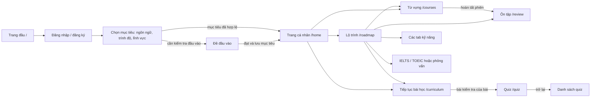

# Kiểm kê luồng người học hiện tại

**Ngày đối chiếu mã nguồn:** 25/10/2026. **Phạm vi:** giao diện người học và API trong workspace này. Đây là mô tả **cách code hiện đang xử lý**, không phải thiết kế mong muốn trong `learning-path-plan.md`. Chưa đăng nhập vào một tài khoản thật, chạy toàn bộ hành trình trên trình duyệt hoặc đối chiếu cơ sở dữ liệu đang phục vụ `localhost`; dữ liệu và trạng thái cụ thể trên máy người học có thể khác. Các đường dẫn dưới đây là nơi kiểm chứng từng hành vi.

## 1. Bản đồ tổng thể: vào đâu, ra đâu

`App.tsx` ánh xạ URL sang view, dựng sidebar, yêu cầu đăng nhập cho trang học và chặn `/admin` với người không có quyền. Các trang học mở độc lập qua sidebar; không có bộ điều phối bắt buộc hoàn thành mục trước mới mở mục sau. `Back` dùng lịch sử trình duyệt, nếu không có lịch sử thì về `/home`. Nguồn: `frontend/src/App.tsx` (bảng `VIEW_TO_PATH`, `handleBack`, phần render từ dòng ~804).

| Điểm vào | Đường đi đang có | Quay lại / tiếp tục |
|---|---|---|
| `/home` | Mục tiêu, nút nhanh đến từ vựng, ôn tập, quiz, bộ thẻ, nói, viết; hiển thị bài học tiếp tục nếu API trả về | Nút tiếp tục mở `/curriculum?courseId=...&lessonId=...`; nút khóa học gợi ý chỉ mở kho từ vựng `/courses` |
| `/roadmap` | 5 ô: mở mục tiêu/đầu vào, từ vựng, nghe, ôn tập, thống kê; thêm IELTS/TOEIC và phỏng vấn; bên dưới là danh sách khóa → unit → bài | Nút tiếp tục và từng bài mở `/curriculum` trực tiếp; các ô mở tab tương ứng, không có khóa bước |
| `/courses` | Unit → bài → phiên học từ vựng; có nút ôn thẻ đến hạn | Nút Back trong phiên về danh sách từ vựng; mở lại bài đang dở dùng `activeSessionId` |
| `/curriculum` | Danh mục giáo trình → unit → bài; đọc nội dung, mở học từ vựng, bài trước/sau, mở quiz | Tiến độ bài ghi `InProgress` khi vào bài; quay lại trong danh mục hoặc qua lịch sử |
| `/listening`, `/speaking`, `/reading`, `/writing`, `/grammar` | Mỗi tab có danh sách hoạt động và tiến độ riêng | Nút Back theo lịch sử; vào lại chọn hoạt động `InProgress` hoặc chưa xong đầu tiên |
| `/quiz` | Danh sách bài kiểm tra → làm từng câu → nộp → kết quả | “Quay lại” từ player về **danh sách quiz**, vì `activeQuizLesson` chỉ là state của `App` |
| `/review` | Chọn bộ thẻ → thẻ đến hạn hoặc thẻ mới → lật → tự đánh giá | Hết lô hiển thị hoàn tất phiên và nút tải lô tiếp theo; “học từ mới” về `/courses` |
| `/certificate-practice`, `/interview-practice` | Danh mục đề/kịch bản → phiên làm bài → kết quả | Back khi đang làm về danh mục; Back ở danh mục theo lịch sử |

Nguồn chính: `frontend/src/App.tsx`, `frontend/src/features/home/HomeView.tsx`, `frontend/src/features/roadmap/LearningRoadmapView.tsx`.

## 2. Từ người dùng mới đến mục tiêu học

1. Sau đăng nhập, app tải mục tiêu học đã lưu. Nếu chưa có, tại `/home` hoặc `/courses` sẽ mở hộp chọn mục tiêu. Trang học có thể không có nội dung khi thiếu mục tiêu.
2. Người học chọn **ngôn ngữ → trình độ → một hoặc nhiều lĩnh vực**. Danh sách trình độ được lọc theo ngôn ngữ; lĩnh vực theo ngôn ngữ và trình độ. Đổi ngôn ngữ/trình độ làm chọn lại lĩnh vực.
3. Với người học mới hoặc đổi ngôn ngữ/trình độ, `handleConfirm` chuyển sang kiểm tra đầu vào. Code lấy **khóa học phù hợp đầu tiên** trong ngôn ngữ + trình độ + lĩnh vực đã chọn để mở đề; nếu không có thì báo không có đề. Nếu đạt, callback nhận `placementProof` và lưu mục tiêu mới ngay. Đóng/chưa đạt không đi qua nhánh lưu này. Khi chỉ sửa mục tiêu mà không cần kiểm tra, lưu trực tiếp.
4. Đổi mục tiêu làm app xóa dữ liệu học offline cũ và tải lại tài liệu theo mục tiêu mới; dữ liệu tiến độ backend vẫn thuộc tài khoản, nhưng các truy vấn trang người học lọc theo mục tiêu hiện tại.

Nguồn: `frontend/src/features/onboarding/StudyTargetModal.tsx` (`requiresPlacementTest`, `openExam`, `handleExamPass`, `handleConfirm`), `frontend/src/App.tsx`, `backend/src/LanguageLearning.Application/Services/StudyTargetService.cs`, `PlacementService.cs`.

## 3. “Lộ trình” và “tiếp tục học” hiện có nghĩa gì

Trang `/roadmap` gồm hai lớp khác nhau:

- **5 ô hướng dẫn phía trên** là các liên kết tĩnh. Ô 1 mở hộp mục tiêu; 4 ô tiếp theo mở từ vựng, nghe, SRS, thống kê. Chúng không kiểm tra điều kiện hoàn thành và không bao gồm đủ cấu trúc → bốn kỹ năng → kiểm tra theo từng unit.
- **Tiến độ thực phía dưới** gọi `progressApi.getRoadmap()`, hiển thị số bài Completed và cây khóa/unit/bài. Nhấn một bài bất kỳ mở `/curriculum` của bài đó. Nút tiếp tục dùng `nextCourseId`/`nextLessonId` từ API.

Trên `/home`, API `getResume()` ưu tiên bài có `LessonProgress=InProgress` được truy cập gần nhất trong mục tiêu hiện tại; nếu không có thì lấy bài chưa hoàn thành tiếp theo từ roadmap. Vì vậy nút tiếp tục **đưa về bài giáo trình**, không tự trả về bước từ vựng đang làm, câu kỹ năng đang làm hay phiên SRS đang dở. Những phần này có nút tiếp tục riêng trong trang của chúng. Mở bài giáo trình ghi `InProgress`; frontend không được tự gửi `Completed`. Nguồn: `backend/src/LanguageLearning.Application/Services/ProgressService.cs`, `frontend/src/features/home/HomeView.tsx`, `frontend/src/features/roadmap/LearningRoadmapView.tsx`, `frontend/src/features/courses/CourseCatalogView.tsx`.

## 4. Học từ vựng: một bài và hai vòng tối đa

**Vào:** sidebar “Từ vựng” → `/courses` → mở unit → chọn bài. Bảng hiển thị `completedGroups / availableGroups`; tên “nhóm” là trường API cũ, trong code hiện tại tính **một đơn vị hoàn thành cho mỗi bài**, không phải mỗi cụm ba từ. Nếu bài có phiên active, nút tiếp tục mở lại phiên/đúng `Position` đã lưu. Nguồn: `frontend/src/features/vocabulary/VocabularyHubView.tsx`, `backend/src/LanguageLearning.Application/Services/VocabularySessionService.cs`.

**Trong phiên:** backend chọn từ chưa từng được giới thiệu trong phiên hoàn tất của bài, xây các cụm tối đa ba từ. Mỗi từ được giới thiệu cùng nghĩa, phiên âm, ví dụ, âm thanh nếu dữ liệu có; giao diện thử phát âm khi bước mở. Sau phần giới thiệu là chuỗi dạng câu: nghe chọn nghĩa, điền từ có ngữ cảnh (khi dữ liệu đủ), ghép cặp hai cột, nghe gõ lại. Câu trả lời gửi về server, chấm đúng/sai, lưu kết quả và tăng vị trí từng bước. UI hiện phản hồi và phát âm báo đúng/sai. Ghép cặp xáo thứ tự nghĩa ở phía giao diện. Nguồn: `VocabularyLearningView.tsx`, `MatchingBoard.tsx`, `VocabularySessionService.cs`.

**Qua vòng 1:** nếu tất cả câu vòng 1 đúng, server cho `canCompleteAfterRoundOne`; nút bỏ qua vòng 2 gọi endpoint hoàn thành ngay. Nếu sai, vòng 2 chỉ giữ **kiểu bài và từ đã sai**. Nếu đúng hết nhưng người học chọn tiếp tục thay vì bỏ qua, phần vòng 2 đã dựng trước vẫn có thể chạy; đây là lựa chọn UI hiện tại. Phiên cũ đã lưu theo cấu trúc trước đó được tiếp tục theo `StepsJson` cũ; khác biệt dữ liệu cũ có thể khiến người học thấy số bước lặp không giống phiên mới.

**Kết thúc:** server đóng phiên, tạo/cập nhật thẻ cá nhân và lịch SRS cho các từ đã giới thiệu: từ trả lời đúng hẹn khoảng 1 ngày, từ có lỗi hẹn khoảng 10 phút. Bài giáo trình chỉ chuyển Completed từ nhánh này nếu mọi từ phù hợp của bài đã học **và bài không có câu quiz**. Nếu bài có quiz, học xong từ vựng chưa hoàn tất bài giáo trình. Back khi chưa xong về danh sách; mở lại cùng bài phục hồi phiên. Nguồn: `VocabularySessionService.CompleteSessionAsync`, `frontend/src/features/reviews/VocabularyLearningView.tsx`.

## 5. Giáo trình, cấu trúc và bốn kỹ năng

`/curriculum` là danh mục bài và nội dung bài, có liên kết phiên từ vựng và quiz. Nó không tự dẫn người học qua ngữ pháp và đủ bốn kỹ năng trước quiz. Mỗi tab kỹ năng lấy hoạt động từ JSON tài liệu của khóa theo mục tiêu hiện tại; chọn hoạt động tạo/cập nhật tiến độ riêng. Hook tiếp tục ưu tiên hoạt động `InProgress`, nếu không có thì hoạt động chưa hoàn tất đầu tiên. Các tab không khóa nhau và tiến độ riêng không tự tăng `LessonProgress` của giáo trình. Nguồn: `frontend/src/App.tsx` phần tải `curriculumStore`, `frontend/src/features/practice/useSkillProgress.ts` (hoặc hook tương ứng), `backend/src/LanguageLearning.Application/Services/SkillPracticeService.cs`.

| Tab | Người học thao tác | Kết quả được lưu | Khi rời / trở lại |
|---|---|---|---|
| Nghe | Chọn hoạt động, nghe/TTS, có thể mở bản chép, chọn đáp án | Server so `correctIndex`; đúng → `Completed`, sai giữ `InProgress`, số lượt/câu đúng tăng | Chọn hoạt động đang dở trong danh sách |
| Nói & phát âm | Xem câu/đối thoại theo nhân vật, nghe mẫu, dùng nhận dạng giọng nói của trình duyệt | Khi có transcript, ghi `Practiced`; không có chấm phát âm tự động theo rubric cho tab tổng quát | Tiến độ là đã luyện, không đồng nghĩa đạt chuẩn phát âm |
| Đọc | Đọc đoạn, chọn đáp án | Đúng → `Completed`, sai còn `InProgress` | Tiếp tục hoạt động chưa đúng |
| Viết | Xem đề, nhập bài và lưu | Tạo bài nộp/bản viết, tiến độ `Practiced`; tab này chưa tự chấm điểm nội dung | Mở lại danh sách; cần kiểm tra UI để biết bản đã lưu có được nạp vào editor hay không |
| Ngữ pháp | Xem giải thích rồi trả lời trắc nghiệm | Đúng → `Completed`, sai còn `InProgress` | Hoạt động độc lập với thứ tự khóa |

Ở các hoạt động trắc nghiệm, hiệu ứng/âm báo đúng sai là phản hồi phía giao diện; nguồn điểm/trạng thái vẫn là API. Nguồn: `frontend/src/features/listening`, `speaking`, `reading`, `writing`, `grammar`; `SkillPracticeService.cs`, `WritingSubmissionService.cs`.

## 6. Ba loại kiểm tra không cùng một tiến độ

### 6.1 Kiểm tra đầu vào / lên trình độ

Chạy trong modal chọn mục tiêu. Chọn khóa có đề đầu vào phù hợp, làm bài, nộp; chỉ nhánh đạt trả `placementProof` để lưu mục tiêu. Đây không phải quiz cuối bài. Nguồn: `StudyTargetModal.tsx`, `ExamRunnerModal.tsx`, `PlacementService.cs`.

### 6.2 Quiz cuối bài (`/quiz`)

Danh sách hiển thị bài theo mục tiêu (có phân trang 8 mục). Chọn bài thì frontend tải câu, giữ câu trả lời **trong state của trang**; đi từng câu rồi gửi tất cả một lần. Server chấm số câu đúng trên tổng câu, ngưỡng đạt **70%**, ghi `QuizAttempt` và đáp án. Đạt thì `LessonProgress=Completed`; không đạt có thể làm lại. Khi sang màn kết quả, “làm lại” tải đề từ đầu, “quay lại” trả về danh sách quiz. Reload/thoát giữa bài không có phiên quiz để khôi phục từng câu. Không thấy kiểm tra điều kiện đã học từ vựng/bốn kỹ năng trước khi mở quiz. Nguồn: `frontend/src/features/quiz/QuizHubView.tsx`, `QuizPlayerView.tsx`, `backend/src/LanguageLearning.Application/Services/QuizService.cs`.

### 6.3 IELTS/TOEIC và phỏng vấn

Hai tab riêng trên sidebar/roadmap. Danh mục IELTS/TOEIC chia theo loại; phỏng vấn lọc theo nghề/lĩnh vực và trình độ hiện tại. Không có nội dung thì UI cho trạng thái trống, không tạo phiên. Chọn đề/kịch bản tạo phiên `InProgress` hoặc tiếp tục phiên đã có. Mỗi câu trả lời được lưu server ngay; phần nói có thể thu âm, phụ thuộc khả năng trình duyệt. Nếu đề có thời lượng, hết giờ tự nộp. Nộp thủ công cần đủ câu; câu trắc nghiệm chấm điểm khách quan, nói/viết chuyển `PendingReview` để quản trị viên đánh giá; sau đánh giá thành `Reviewed`. Điểm ở đây là điểm theo nội dung import, không tự quy đổi band IELTS hay thang TOEIC chính thức. Back từ phiên về danh mục, từ danh mục theo lịch sử. Không thấy hai luồng này cập nhật `LessonProgress` hay mở khóa chặng tiếp theo của roadmap. Nguồn: `frontend/src/features/specialPractice/SpecialPracticeView.tsx`, `backend/src/LanguageLearning.Application/Services/SpecialPracticeService.cs`.

## 7. Ôn tập ngắt quãng: nguồn thẻ, lịch, một phiên

**Nguồn thẻ:** hoàn tất phiên từ vựng tạo thẻ trong bộ cá nhân và gắn lịch đầu tiên; người học cũng có thể tự tạo bộ/thẻ ở “Bộ thẻ của tôi”, nhập file hoặc thêm nhanh trong `/review`. “Kho thẻ cộng đồng” là luồng người dùng chia sẻ/sao chép sang bộ cá nhân, không phải danh sách thẻ import giáo trình mặc định. Từ điển/sổ tay có hành động lưu riêng; việc bôi đen không tự coi là một lần ôn tập. Nguồn: `VocabularySessionService.cs`, `MyDecksView.tsx`, `PublicDecksView.tsx`, `NotebookWidget.tsx`.

**Mở `/review`:** mặc định lấy tối đa 30 thẻ `due`, có thể lọc bộ thẻ hoặc đổi sang thẻ `new` (chưa có lịch). Ba số đếm là đến hạn, đã có lịch ở tương lai và chưa gặp; không phải ba cột tiến độ giáo trình. Thẻ hiện mặt trước, người học bấm lật rồi **tự đánh giá** Again/Hard/Good/Easy. API lưu ReviewEvent và lịch mới; UI chuyển sang thẻ kế. Hết lô thì báo xong lượt hiện tại, nút kiểm tra lại tải lô kế. Nếu không có thẻ đến hạn, UI nêu lần ôn tiếp theo khi API trả về; “Học từ mới” dẫn `/courses`. Nguồn: `SrsReviewView.tsx`, `SrsService.cs`.

**Quy tắc hẹn:** mới học đúng → 1 ngày, sai → khoảng 10 phút. Khi tự đánh giá: Again đặt lại ~10 phút, Hard rút nhịp, Good thường 1 ngày rồi 6 ngày rồi nhân theo ease, Easy đi nhanh hơn (lần đầu 4 ngày). Đây là SRS theo mức tự nhớ của thẻ, **không** tự lấy điểm nghe/nói/đọc/viết hoặc quiz làm rating cho thẻ; từ `new` chỉ có lịch sau lần người học đánh giá. Nguồn: `backend/src/LanguageLearning.Application/Services/SrsScheduler.cs`, `SrsService.cs`.

## 8. Các nhánh phụ người dùng có thể mở độc lập

- **Bộ thẻ của tôi:** tạo/sửa/xóa bộ, quản lý thẻ, nhập/xuất và mở ôn SRS cho một bộ; quay lại qua sidebar. **Kho thẻ cộng đồng:** xem/tìm bộ công khai rồi sao chép sang bộ cá nhân; sao chép xong app mở “Bộ thẻ của tôi”.
- **Sổ tay và từ điển:** widget sổ tay hiển thị trên shell; có thể mở thủ công. Khi chọn chữ, người học có thể chọn tra hoặc thêm sổ tay, không tự lưu chỉ vì chọn chữ. Đây chưa phải bước bắt buộc của lộ trình.
- **Thư viện/podcast, bảng IPA, hội thoại AI, thống kê, bảng xếp hạng, đồng bộ:** các tab độc lập. Thống kê tổng hợp hoạt động đã ghi từ nhiều bảng; không điều khiển thứ tự bài. Bảng xếp hạng nằm ở tab riêng sau ôn tập trên sidebar.

Nguồn: `frontend/src/App.tsx` phần sidebar/render; `frontend/src/features/decks/MyDecksView.tsx`, `sharing/PublicDecksView.tsx`, `frontend/src/components/notebook/NotebookWidget.tsx`, `frontend/src/components/dictionary/QuickDictionaryModal.tsx`, `backend/src/LanguageLearning.Application/Services/StatisticsService.cs`.

## 9. Dữ liệu nào quyết định trạng thái nào

| Dữ liệu | Tạo/cập nhật khi nào | Dùng để hiện ở đâu |
|---|---|---|
| `StudyTarget` | Chọn mục tiêu, đạt bài đầu vào khi bắt buộc | Lọc khóa, tài liệu, trình độ, lĩnh vực |
| `Course.MaterialJson`, unit/lesson, quiz | Admin nhập/xuất bản khóa | Nội dung từ vựng, kỹ năng, đề; không phải tiến độ cá nhân |
| `LessonProgress` | Mở bài → InProgress; quiz đạt hoặc nhánh từ vựng bài không quiz → Completed | Roadmap, Home “tiếp tục bài học”, thống kê bài |
| `VocabularySession` | Bắt đầu/đáp từng bước/hoàn tất một bài từ vựng | Vị trí tiếp tục và số bài từ vựng đã học |
| `SkillPracticeProgress` | Chọn hoạt động, trả lời hoặc xác nhận đã luyện | Tiến độ từng tab kỹ năng; độc lập với bài giáo trình |
| `QuizAttempt` | Nộp quiz cuối bài | Điểm, lịch sử bài kiểm tra, điều kiện Completed của bài |
| `SpecialPracticeAttempt` | Bắt đầu/lưu từng câu/nộp/được chấm | Tiếp tục IELTS/TOEIC, phỏng vấn và kết quả riêng |
| `CardSchedule`, `ReviewEvent` | Học xong từ / đánh giá thẻ | Due/new, lịch ôn, số ôn và thống kê |
| `WritingSubmission` | Lưu bài viết | Nội dung bài đã nộp; khác với điểm quiz |

Các trạng thái này hiện **không hợp thành một trạng thái chặng học duy nhất**. Ví dụ, một bài có thể hoàn tất từ vựng, có thẻ SRS đến hạn, kỹ năng nói `Practiced`, nhưng bài giáo trình vẫn `InProgress` nếu quiz chưa đạt. Đó là hệ quả trực tiếp của các điều kiện cập nhật khác nhau ở từng service.

## 10. Các đường quay lại, tải lại và lỗi cần biết khi thiết kế flow mới

1. **Từ vựng:** vị trí mỗi bước lưu backend; rời giữa phiên rồi mở lại đúng bài thì tiếp tục. Sau khi server hoàn tất, quay về hub cập nhật bộ đếm. Nút hoàn thành sớm chỉ hợp lệ khi vòng 1 không sai.
2. **Kỹ năng:** mỗi hoạt động có tiến độ riêng; resume chọn hoạt động, không khôi phục thao tác chưa gửi (ví dụ chữ đang gõ). Nói/viết dùng `Practiced`, không tương đương đạt.
3. **Quiz cuối bài:** câu trả lời trước khi nộp ở bộ nhớ trình duyệt của component; rời/tải lại thì bắt đầu lại. Kết quả đã nộp lưu server. `activeQuizLesson` không nằm trong URL nên refresh `/quiz` trở về danh sách.
4. **IELTS/TOEIC, phỏng vấn:** lưu theo từng câu và tiếp tục phiên server; thời hạn tính từ lúc tạo phiên, trở lại sau khi hết giờ sẽ chốt phiên. Các đề thiếu nội dung chỉ ra trạng thái trống.
5. **SRS:** sau mỗi rating API đã lưu lịch; rời giữa lô rồi quay lại sẽ tải lại các thẻ còn đến hạn theo thời điểm mới, không khôi phục chỉ số `index` cũ. “Hoàn tất phiên” chỉ nghĩa là hết lô vừa lấy, không có nghĩa đã hoàn thành mọi thẻ trong toàn bộ mục tiêu.
6. **Roadmap/Home:** nút tiếp tục ưu tiên `LessonProgress`, nên không biết chính xác người học đang ở câu từ vựng, câu kỹ năng hay thẻ SRS nào. Nút riêng của từng tab mới phục hồi đến cấp đó.
7. **Tải dữ liệu:** App gom tài liệu từ các khóa phù hợp bằng `Promise.allSettled`; khóa tải lỗi có thể bị bỏ qua khỏi kho kỹ năng. Các API lỗi khác có vùng retry/alert tùy trang. Kiểm kê này chưa chứng minh môi trường API/MySQL hiện tại hoạt động không lỗi.

## 11. Ví dụ đường đi thực tế

**Người mới:** đăng nhập → chọn English/A1/lĩnh vực → làm đề đầu vào nếu được yêu cầu → lưu mục tiêu → `/home` → bấm “Từ vựng” → unit/bài → hoàn tất vòng 1 hoặc ôn lỗi vòng 2 → sinh thẻ SRS → `/review` khi đến hạn. Nếu bài có quiz, muốn thấy bài Completed phải vào quiz và đạt 70%; các kỹ năng không được ép học trước.

**Người quay lại giữa phiên:** `/home` có thể trỏ tới bài `/curriculum` đang InProgress; từ sidebar vào `/courses` mới thấy nút “Tiếp tục” phiên từ vựng; vào tab kỹ năng thấy hoạt động dở; vào luyện thi thấy phiên đề dở. Có nhiều điểm tiếp tục song song.

**Người ôn:** `/review` → chọn thẻ due → lật → tự chấm → lịch mới. Nếu due=0, trang có thể vẫn còn thẻ `new`; đổi tab “thẻ mới” để bắt đầu chúng. Học xong từ ở `/courses` có thể chưa hiện ngay ở due vì lịch đầu tiên thường ở tương lai.

## 12. Những quyết định cần chốt trước khi đổi phương pháp học

Đây là các chỗ **chưa được thống nhất bởi code hiện tại**, không phải tính năng đã có:

1. Chặng học chính là **unit, bài hay một nhóm từ**? Ba màn đang tính tiến độ theo đơn vị khác nhau.
2. Mỗi chặng có bắt buộc đi **mục tiêu → từ vựng → cấu trúc → nghe/nói/đọc/viết → quiz** không? Hiện có thể mở tự do; roadmap phía trên chỉ là liên kết.
3. Điều kiện Completed của chặng nên là quiz đạt, đủ hoạt động kỹ năng, đủ từ vựng, hay tổ hợp? Hiện `LessonProgress` chỉ được đổi ở một số nhánh.
4. “Tiếp tục học” nên đưa về một hoạt động ưu tiên chung hay giữ nhiều nút tiếp tục theo tab? Hiện backend chỉ resume bài giáo trình.
5. Câu sai trong học từ cần lặp ngay bao nhiêu lần, còn thẻ SRS là lần ôn **sau buổi học** thế nào? Hai loại lặp hiện tồn tại riêng.
6. Bài nói/viết `Practiced` có được coi là hoàn tất chặng không, hay cần đánh giá? Quiz khách quan và luyện thi tự luận hiện có cơ chế chấm khác nhau.
7. IELTS/TOEIC và phỏng vấn là nhánh tự chọn hay bước sau khi hoàn thành một trình độ/nghề? Hiện là nhánh độc lập.

Tài liệu này là mốc đối chiếu để bạn quyết định flow mới; khi chốt quy tắc, cần sửa đồng bộ điều kiện backend, nút điều hướng, mô hình tiến độ và JSON template.
